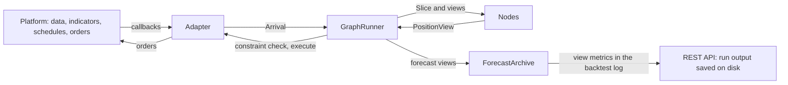

# Sugarloaf

Sugarloaf runs quantitative strategies on QuantConnect as graphs of Python nodes. A node
declares the data it needs (bars, quotes, datasets, universes, native indicators, schedules,
warm-up) and implements callbacks in the shape of a QuantConnect alpha model. It publishes a
forecast or a desired position; other nodes combine forecasts, allocate capital or check
account limits. `GraphRunner` sets the declarations up on an adapter, dispatches the
platform's callbacks to the nodes in dependency order and hands the final position target to
the adapter, which orders through the platform's own API.



## What it provides

- **A node interface close to LEAN's.** `update(ctx, data, views)`,
  `on_securities_changed(ctx, added, removed)`, `on_scheduled(ctx, name, views)`; the
  platform keeps windows and indicators, read through `ctx.window` and `ctx.indicator`.
- **Typed messages between nodes.** Predictive views state a target (instrument, horizon,
  units) and a statement (estimate, probability, distribution, ordering or score); a
  `PositionView` states desired account weights or quantities.
- **Composition.** Graphs are compiled with port and semantic checks. Built-in nodes cover
  native-indicator scores, mean aggregation, positive-signal allocation, branch netting and
  account constraints.
- **Forecast runs.** A graph ending in a predictive port runs as a backtest that archives
  every view; a research notebook scores the archive against later prices.
- **Explicit deployments.** A TOML manifest selects a factory and its source files; the
  cloud tooling retains the uploaded source and the retrieved results.

## Start locally

Python 3.11+ and [uv](https://docs.astral.sh/uv/) are required. From the repository root:

```powershell
uv sync --cache-dir .uv-cache
uv run --cache-dir .uv-cache python -m examples.memory
```

Expected output: `{'holdings': 50.0, 'orders': 1, 'diagnostics': 1}`. Two scheduled branches
are netted into one 50% target and filled on the memory adapter; the diagnostic is the
netter waiting for its second branch. Continue with the [guide](docs/GUIDE.md).

## Run on QuantConnect

With QuantConnect credentials and a selected project:

```powershell
sugarloaf run --adapter quantconnect --manifest deployments/quantconnect/ema.toml
```

The command uploads, compiles, backtests and saves results and logs under `artifacts/ema/`.
`sugarloaf create` with the same arguments provisions a project once;
`sugarloaf package` builds the bundle offline. [Deployment](docs/technical/DEPLOYMENT.md)
covers parameters, individual actions and evidence.

## Documentation

| Topic | Page |
| --- | --- |
| Parts and call chains | [Architecture](docs/ARCHITECTURE.md) |
| Declarations, slices, nodes, views, graphs | [Core](docs/technical/CORE.md) |
| Dispatch, view carriage, terminal target | [Runtime](docs/technical/RUNTIME.md) |
| QuantConnect mapping and the memory adapter | [Adapters](docs/technical/ADAPTERS.md) |
| Allocation, netting, constraints | [Portfolio](docs/technical/PORTFOLIO.md) |
| Order sizing and feedback | [Execution](docs/technical/EXECUTION.md) |
| Forecast runs and scoring | [Research](docs/technical/RESEARCH.md) |
| Factories, manifests, cloud runs | [Deployment](docs/technical/DEPLOYMENT.md) |
| Signatures and docstrings | [API reference](docs/api/index.md) |
| Tests and diagnosis | [Maintenance](docs/MAINTENANCE.md) |
| Native evidence and limits | [Validation](docs/VALIDATION.md) |

[Examples](examples/README.md) and [built-in nodes](sugarloaf/nodes/README.md) are
starting points; private strategies live in an
[external package](docs/EXTERNAL_STRATEGIES.md). Examples teach mechanics; their results
are not evidence of an edge.

## Status

The current design (declarations, `GraphRunner`, adapters as mappings) has local test
coverage only. The native QuantConnect checks it still needs are listed in
[validation](docs/VALIDATION.md#redesign-of-14-november-2026). QuantConnect data covers US
equities and indices; orders are market, market-on-open and market-on-close. There is no
live restart or recovery of runner state.

For development:

```powershell
uv run --cache-dir .uv-cache pytest
uv run --cache-dir .uv-cache ruff check .
```
