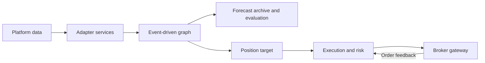

# Sugarloaf

Build and backtest quantitative strategies on QuantConnect as graphs of Python nodes. A node publishes a
forecast or desired position; other nodes combine those messages, allocate
capital, or enforce portfolio constraints. Research and trading share node and
runtime contracts. QC hosts callbacks, native data, clocks, indicators and order
APIs; Sugarloaf owns graph decisions, trading sessions and execution reconciliation.

## Design in one picture



The graph defines the strategy. The adapter owns data, indicators, calendars and
broker state. Execution compares the target with actual holdings and pending
orders. Native platform APIs stay out of signal code.

## What you can build

- **Composable signals and allocations.** Six predictive View families express
  returns, relative returns, probabilities, distributions, rankings and scores.
  Position Views express desired account weights or quantities.
- **Causal event processing.** Declared requirements, receipt times, a monotonic
  data clock and selective evaluation determine what each node can see.
- **Predictive research without a trading account.** Replay a fresh node, archive
  issued forecasts and resolve exact outcomes separately, including missing labels.
- **Multiple portfolio branches.** Net explicitly budgeted contributions,
  preserve attribution and reject infeasible account targets.
- **Broker-aware execution.** Reconcile holdings and pending exposure, handle
  cumulative partial fills, retain reservations through cancellation and uncertain
  submission, and check risk before each order.
- **Explicit deployment bundles.** Select a factory and source files in TOML;
  preserve actual uploaded source and retrieved run evidence.

Built-in [EMA, RSI and SMA nodes](sugarloaf/nodes/README.md), mean aggregation and
positive-signal allocation provide transparent starting rules. Examples teach
mechanics rather than establish predictive value.

## Start locally

Python 3.11+ and [uv](https://docs.astral.sh/uv/) are required for these commands.
From the repository root:

```powershell
uv sync --cache-dir .uv-cache
uv run --cache-dir .uv-cache python -m examples.memory
```

The example combines two position branches and applies explicit fixture fills.
Expected output: `{'holdings': 50, 'orders': 1, 'diagnostics': 0}`.
It needs no QC account or market data. Continue with the
[10–15 minute getting-started guide](docs/GUIDE.md).

## Explore the implementation

For a QC backtest, use the installed `sugarloaf` command in an authenticated
LEAN environment. Select the manifest explicitly:

```powershell
sugarloaf run --adapter quantconnect --manifest deployments/quantconnect/ema.toml
```

The command uploads, compiles, waits for completion and saves results and logs in
`artifacts/ema/`. It requires a project selected in the manifest or saved state.
If neither selects a project, run `sugarloaf create --adapter quantconnect --manifest deployments/quantconnect/ema.toml`
once. For offline source inspection, use `sugarloaf package --adapter quantconnect --manifest deployments/quantconnect/ema.toml`.
The [deployment guide](docs/technical/DEPLOYMENT.md) covers parameter overrides,
Python usage, individual actions and polling limits.

| Learn about | Start here |
| --- | --- |
| End-to-end design and call chains | [Architecture](docs/ARCHITECTURE.md) |
| Views, nodes and graph compilation | [Core](docs/technical/CORE.md) |
| Data requirements, Context and readiness | [Market services](docs/technical/MARKET.md) |
| Events, clocks, activation and expiry | [Runtime](docs/technical/RUNTIME.md) |
| Allocation, netting and constraints | [Portfolio](docs/technical/PORTFOLIO.md) |
| Reconciliation, risk and order feedback | [Execution](docs/technical/EXECUTION.md) |
| Memory and QuantConnect services | [Adapters](docs/technical/ADAPTERS.md) |
| Replay, forecast archives and metrics | [Research](docs/technical/RESEARCH.md) |
| Factories, bundles and cloud tools | [Deployment](docs/technical/DEPLOYMENT.md) |
| Classes, signatures and docstrings | [API reference](docs/api/index.md) |
| Tests, diagnostics and safe changes | [Maintenance](docs/MAINTENANCE.md) |

[Examples](examples/README.md) teach specific paths through the framework.
An optional [separate strategy repository](docs/EXTERNAL_STRATEGIES.md) can keep
models, notebooks and private configuration outside the reusable library.
Sugarloaf does not import strategy packages by name.

## Current scope

QuantConnect is the first native platform adapter. Trading currently supports US
equities with regular-session day market orders. Native indicators depend on
LEAN; memory services supply deterministic fixtures, not a market simulator.
Live restart/recovery and durable runtime state are not implemented.

Local tests establish framework behavior. Recorded cloud checks apply to their
saved source snapshots, including the native EMA QuantBook notebook. See
[validation and capability limits](docs/VALIDATION.md) before relying on a path.

For development:

```powershell
uv run --cache-dir .uv-cache pytest
uv run --cache-dir .uv-cache ruff check .
```
