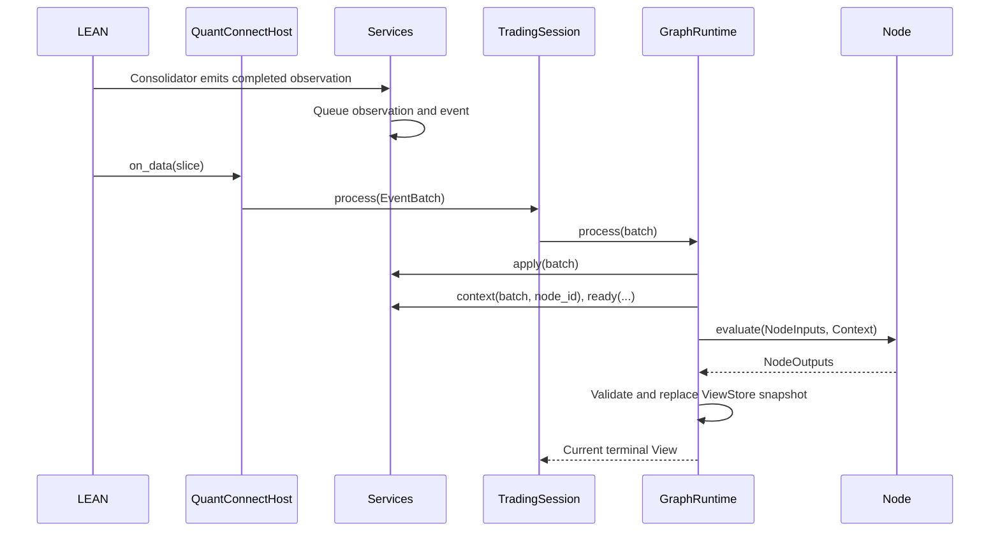

# Architecture

Sugarloaf runs strategy graphs inside QuantConnect while separating strategy
decisions from native platform services. QC hosts callbacks, data, clocks,
indicators and order APIs. Sugarloaf retains graph evaluation, trading sessions,
risk checks and execution reconciliation. Core
types are neutral Python contracts; nodes contain strategy calculations; adapters
implement services. Research observes forecasts. A trading session attaches an
execution engine to an explicit position output.

## Package responsibilities

| Package | Principal objects | Responsibility |
| --- | --- | --- |
| `core` | `Metadata`, Views, `Node`, `Graph`, `Context` | Identity, messages, interfaces and wiring |
| `market` | Requirements, `Trigger`, `Schedule`, observations | Neutral resource and data declarations |
| `runtime` | `GraphRuntime`, `ViewStore` | Admission, clock, activation and current outputs |
| `nodes` | Indicator signals, aggregation, allocation, netting | Reusable strategy rules |
| `portfolio` | Constraint/valuation helpers | Account-weight arithmetic and feasibility |
| `execution` | `TradingSession`, `ExecutionEngine`, `RiskGate` | Target authority, order ledger and reconciliation |
| `adapters` | `ProviderServices`, memory and QC implementations | Data/account reads and platform translation |
| `research` | `run_node`, `ForecastArchive`, resolvers, `evaluate` | Replay and predictive diagnostics |
| `cli` | `main` | Select the requested adapter and forward arguments without parsing manifests |
| `deployment` | `Deployment`, `Environment`, evidence/reporting | Shared configuration and retained evidence |
| `adapters.quantconnect.cloud` | Packaging, backtests, notebooks | Local QC bundles, cloud operations and remote research kernels |

## Startup

`sugarloaf run --adapter quantconnect --manifest PATH` enters the shared CLI.
It loads the selected adapter command module lazily. The QC command reads its
manifest, prepares sources, submits a backtest and collects evidence. Adapter
entry modules implement `main(argv, *, prog) -> int`; each owns its actions,
manifest format and validation. A concrete new adapter adds its command module
and an explicit route in `cli.py`, keeping provider logic in that adapter.

The QC [entry point](../sugarloaf/adapters/quantconnect/main.py) delegates
initialization to [the launcher](../sugarloaf/adapters/quantconnect/launcher.py).
The selected factory returns a `Deployment`. Its graph factory constructs fresh
nodes; the launcher configures the environment and creates `QuantConnectHost`.

The host composes services, gateway, engine and `TradingSession`.
Creating `GraphRuntime` installs each node's requirements/triggers in topological
order. The provider shares compatible resources and prepares subscriptions,
consolidators, indicator history and calendars. Node state belongs to this run;
compiled wiring does not make node instances safe to reuse.

## Market callback to decision



For a five-minute EMA signal, the provider admits a completed source bar and native
indicator points. A matching trigger activates the signal. Its changed score
activates allocation; the final position target is passed to execution.
Nodes do not directly read a QC Slice. They use their declared services through
a batch-bound `Context`.

Observation end and receipt are separate. Graph time advances to the latest event
end and never moves backward. Provider admission excludes unavailable/future values.
A node can be activated without being ready; readiness failures withdraw its output.
The [runtime reference](technical/RUNTIME.md) specifies this ordering.

## Position to order and feedback

```text
TradingSession.process
  → ExecutionEngine.accept(target)
  → reconcile()
  → fresh gateway Context
  → desired quantity − holdings − pending exposure
  → RiskGate.check
  → reserve OrderIntent identity
  → gateway.submit
  → bind platform order ID
```

A USD10,000 account targeting 50% at USD100 per share wants 50 shares.
With 20 already held and 30 pending, the remaining delta is zero.
Canceled targets do not imply canceled orders until terminal feedback confirms it.

LEAN feedback reaches `QuantConnectHost.on_order_event`. The host queues callbacks,
reads signed cumulative fills from the ticket, applies all queued updates, then
reconciles. This also handles synchronous feedback during submission without
counting a fill in both holdings and local pending exposure.
[Execution](technical/EXECUTION.md) describes cancellations and unknown submissions.

## Research path

```text
run_node(factory, provider, start, end)
  → fresh node and GraphRuntime(on_output=archive.record)
  → provider.prepare
  → provider.history_batches → runtime.process
  → ForecastArchive
  → separate OutcomeResolver → evaluate → EvaluationReport
```

The archive retains issued forecasts after runtime replacement, withdrawal or
expiry. Outcome data never become node inputs. Predictive evaluation needs neither
a position output nor broker execution. Actual portfolio P&L requires a trading
path and its execution assumptions.

## State and extension boundaries

| State | Owner and lifetime |
| --- | --- |
| Model/calibration/strategy memory | Node instance, one run |
| Subscriptions, buffers, native indicators | Provider, shared by declared owners |
| Active Views and bounded identity ledger | Runtime, one run |
| Issued forecasts | Research archive, independent of active View expiry |
| Actual holdings and platform orders | Broker/platform |
| Intent reservations and current target | Execution engine, one run |
| Uploaded source/results | Deployment evidence on disk |

Change a signal in its node; add provider behavior in the adapter; change order
semantics in the gateway/engine. Keep cross-component contracts explicit.
The adapter decides whether a corporate action made its retained data unusable,
rebuilds it and reports a `DataReset`; the core holds no vendor rule. The runtime
withdraws the outputs of the nodes that reset names, any View naming an
instrument that ended (a delisting) and any View stated in units of one that
split, and execution authority with them when the terminal target is among those
outputs. The rest of the graph
carries on. Native holdings adjustments remain the platform's responsibility.

Contexts cannot survive provider mutations or the batch that created them.
Runtime, identity and intent state are not durably persisted; restart recovery is
unsupported. [Maintenance](MAINTENANCE.md) maps changes to verification.
