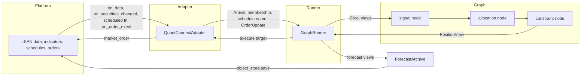

# Architecture

Sugarloaf has three parts, all platform-neutral in their interfaces:

- **Node.** Declares what it needs (`inputs`, `indicators`, `schedules`, `warm_up`), its
  view ports (`ports`, `outputs`) and implements callbacks in the shape of a QuantConnect
  alpha model: `update(ctx, data, views)`, `on_securities_changed(ctx, added, removed)`,
  `on_scheduled(ctx, name, views)`. Its state is its own.
- **Runner** (`GraphRunner`). Reads every node's declarations once, asks the adapter to set
  them up, then forwards each adapter callback to the nodes in topological order, carries
  views along the graph edges and hands a changed terminal position target to the adapter
  for execution after a constraint check.
- **Adapter.** Maps each declaration and each read to one platform call
  (`QuantConnectAdapter` over `QCAlgorithm`; `MemoryAdapter` over bars and prices the caller
  hands it), builds a
  neutral slice from each platform callback and passes it to the runner.

There is one clock: the platform's. Every callback runs at the platform's time and
`ctx.time` is that time.



## Module map

| Package | Modules | Responsibility |
| --- | --- | --- |
| `sugarloaf.core` | `inputs`, `data`, `node`, `graph`, `views`, `universes`, `primitives`, `errors` | Declarations, records and slices, the node protocol, view messages, graph compilation, universe rules |
| `sugarloaf.runtime` | `runner` | `GraphRunner`, `NodeContext`, `Diagnostic` |
| `sugarloaf.adapters` | `protocol`, `memory`, `quantconnect` | The adapter interface and its two implementations; QuantConnect cloud tooling under `quantconnect.cloud` |
| `sugarloaf.execution` | `contracts` | `ExecutionPolicy`, account records, the shared sizing rule |
| `sugarloaf.portfolio` | `constraints` | `PortfolioConstraints`, `violations`, `breaches` |
| `sugarloaf.nodes` | `technical`, `simple`, `positions` | Built-in nodes |
| `sugarloaf.research` | `archive`, `serialization`, `anchors`, `evaluation`, `inference` | Forecast archive, its JSON form, outcome anchors, scoring |
| `sugarloaf.deployment` | `config`, `reporting`, `evidence` | `Deployment`, `Environment`, `ReportContext`, run evidence |

Dependencies point inward: `core` imports only `core`; nodes import `core`, `portfolio` and
the `execution` records; the runner imports `core`, `execution`, `portfolio`,
`research.archive` and the adapter interface (`adapters.protocol`); adapters import what they
map. Only
`sugarloaf.adapters.quantconnect` imports LEAN, and only when a `QuantConnectAdapter` is
built without an injected namespace. Strategy packages depend on Sugarloaf; Sugarloaf
imports no strategy package.

## Start-up on QuantConnect

```text
SugarloafAlgorithm.initialize
  -> launcher.load(load_deployment, algorithm)        factory(parameter[, stored, fetch]) -> Deployment
  -> launcher.start(algorithm, deployment)
       set_start_date ... set_benchmark                 Environment
       QuantConnectAdapter(algorithm, tickers, ...)     security initializer, settings
       GraphRunner(deployment.graph_factory(), adapter, constraints, policy)
       runner.start()
         adapter.subscribe      -> add_security, RollingWindow, consolidator
         adapter.add_universe   -> add_universe(FundamentalUniverse.usa or universe.etf)
         adapter.add_custom     -> add_data
         adapter.add_indicator  -> indicator class, consolidator, warm_up_indicator
         adapter.schedule       -> schedule.on
         adapter.warm_up        -> set_warm_up
       debug("SUGARLOAF_RUN ...")
```

## One slice

```text
LEAN on_data(slice)
  -> SugarloafAlgorithm.on_data -> QuantConnectAdapter.on_data
       pending history fills and warm_up_indicator calls, on first touch, ending before the bar or clock
       bars of feeds without an interval: from slice.bars, added to their windows
       bars of feeds with an interval: completed by consolidator handlers since the last slice
       earnings, fundamentals, borrow; dividends, splits, delistings, symbol changes
       Arrival(time=algorithm.utc_time, ..., warming_up=algorithm.is_warming_up)
  -> GraphRunner.on_data(arrival)
       for node in topological order:
         data = the node's declared part of the arrival
         run update(ctx, data, views) if data is not empty or a producer's outputs changed
         validate outputs; replace the node's outputs
       if the terminal PositionView changed: constraints -> adapter.execute(target, policy)
  -> market_order(symbol, quantity, tag=target id)
```

The node's clock, `ctx.time`, advances only on event streams: LEAN's callbacks `on_data`,
`on_order_event`, `on_securities_changed` and scheduled functions, as QuantConnect's own
algorithm clock advances only with the [time frontier](https://www.quantconnect.com/docs/v2/writing-algorithms/key-concepts/time-modeling/timeslices#02-Time-Frontier)
and its [warm-up](https://www.quantconnect.com/docs/v2/writing-algorithms/historical-data/warm-up-periods)
replay. `QuantConnectAdapter.on_data`, `on_order_event`, `on_securities_changed` and the
scheduled function built in `schedule` forward those events to the runner, and
`QuantConnectAdapter.time` reads LEAN's clock. A history request is not an event stream: its
bars prime rolling windows, indicators and node memory and advance nothing. The fill helper
`_fill` (with `_fill_group` and `fill_before`) passes them to `add_in_order` or to a
consolidator whose bars are not marked for the next slice, `add_in_order` stores a bar in a
window, `update_in_order` updates an indicator, and `history` returns bars to the requesting
node only.

A scheduled function calls `runner.on_scheduled(name)`; the owning node's `on_scheduled`
runs, then its dependents. A universe change calls `runner.on_securities_changed(universe,
added, removed)` after the adapter has created the new members' windows and indicators.
Order events become `OrderUpdate` records in `runner.updates`. `on_end_of_algorithm`
calls `launcher.finish`, which saves the result (and the forecast archive) to the Object
Store.

## Trading and forecast runs

The graph's output port decides the mode. When it declares exactly `(PositionView,)`, the
run trades: the terminal target goes to `adapter.execute`. Otherwise the run is a forecast
run: every predictive view any node emits is recorded in `runner.archive`, saved as
`forecasts.json`, and scored later in a research kernel (`sugarloaf.research.evaluate`).
Research on prices themselves uses `QuantBook` directly in the kernel.

## Ownership

| Owner | Owns |
| --- | --- |
| Node | Its parameters and its state between callbacks |
| Runner | Each node's current views, the last executed target, the forecast archive, diagnostics, order records and updates |
| Adapter | Platform objects (subscriptions, consolidators, windows, indicators, universes, schedules), symbol bindings and universe memberships |
| Platform | The clock, data, indicator values, holdings, open orders, fills, cancellations, corporate-action adjustments |

## Where to read next

[Core](technical/CORE.md) defines declarations, slices, the node protocol and views;
[runtime](technical/RUNTIME.md) the dispatch rules; [adapters](technical/ADAPTERS.md) the
platform mapping; [execution](technical/EXECUTION.md) and [portfolio](technical/PORTFOLIO.md)
targets and orders; [research](technical/RESEARCH.md) forecast runs and scoring;
[deployment](technical/DEPLOYMENT.md) manifests and cloud runs.
